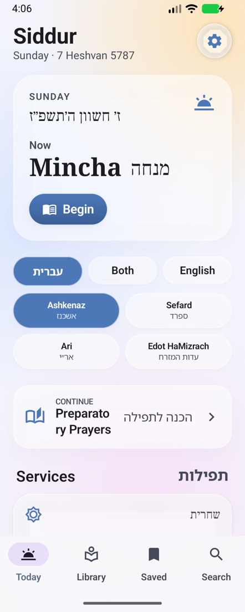
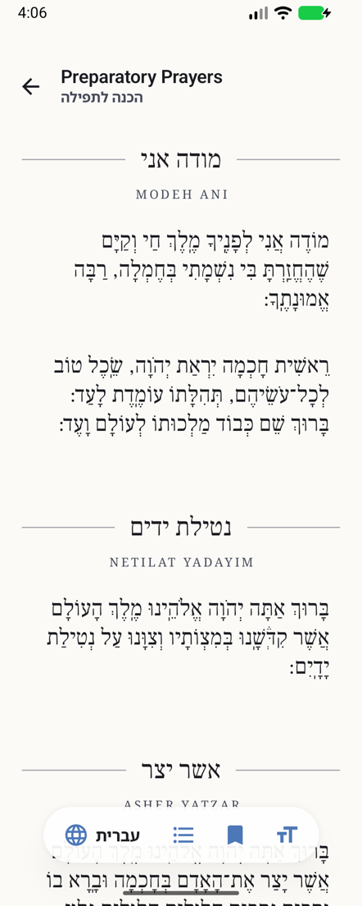
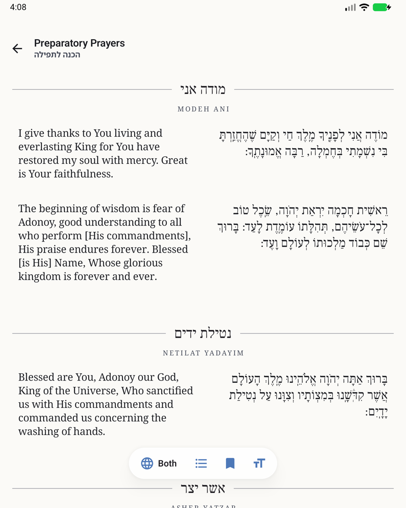
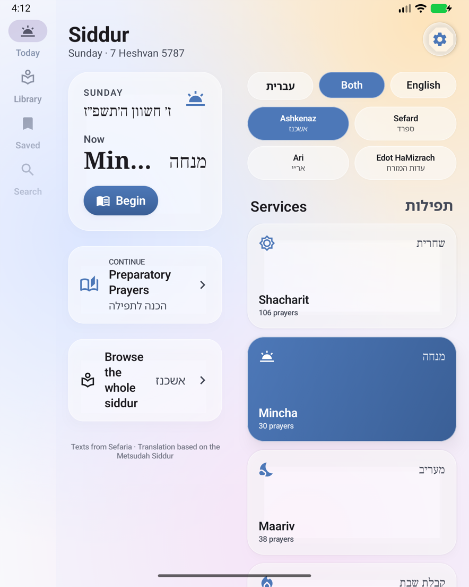

# Siddur for Android

A native Android siddur, the companion to the iOS app in `../glass-siddur`. Hebrew on the right, English on the left, every paragraph paired with its translation, and all 844 prayers of four nusachim bundled so it works offline from the first launch. Jetpack Compose, Material 3, and built for foldables: Galaxy Z Fold, Pixel Fold, and anything else that reports a hinge.

## Features

- **Four nusachim**: Ashkenaz, Sefard, Ari (Chabad, Hebrew only, weekday), Edot HaMizrach.
- **Hebrew by default, as on paper**: a single screen (any phone, or a foldable closed) shows the Hebrew alone. Open a foldable and the translation appears beside it. Each surface keeps its own choice, and Settings can switch the separate open-display choice off.
- **Synced translation**: each paragraph is one row, Hebrew right / English left. Tap a paragraph to highlight it with its translation; in a single-language mode a tap reveals the other language beneath that paragraph. Large type on a phone stacks the pair automatically (the "Auto" layout); side by side or stacked can be forced.
- **Language switch on the front screen**: עברית · Both · English, editing the choice for the screen in view. Also in the reader's floating bar.
- **Typography**: pinch to zoom or use the slider; Hebrew faces Frank Ruhl (default), David, Noto Serif Hebrew and the system families; English Noto Serif (default), Roboto and more. Line spacing, bilingual layout, vowels and cantillation toggles, light / sepia / dark.
- **Traditional page**: bold opening words, small gray rubrics, Hebrew headings between hairlines with spaced small-cap English beneath.
- **Today**: Hebrew date (ICU Hebrew calendar), Shabbat / Rosh Chodesh awareness, and the service for the current time, with optional coarse location for real sunrise and sunset. Nothing leaves the device.
- **Fully offline**: every prayer ships in `app/src/main/assets/texts` (the same JSON the iOS app bundles). Sefaria is only contacted for a ref somehow missing from the bundle.
- Bookmarks, continue reading, search by English or Hebrew title.

## Foldables

What the app does on each surface, driven by Jetpack WindowManager's `FoldingFeature` (`fold/FoldState.kt`):

- **Cover display (closed), and any ordinary phone**: one column, bottom tab bar, Hebrew alone by default.
- **Open like a book (fold vertical)**: the reader becomes a two-page spread. Bilingual text runs English on the left page and Hebrew on the right with the crease as the gutter, and each prayer's title sits on its own page. In a single language the text keeps its page (Hebrew on the right, English on the left) and the facing page carries the section's contents, the language switch and the text-size slider. Today splits the same way: the day and the service on the left page, the pickers and the services grid on the right. The navigation becomes a rail.
- **Half open on a table (fold horizontal, `HALF_OPENED`)**: the text sits on the upright half and the contents and controls on the flat half.
- Flat open with no hinge reported yet (some devices only report the hinge after it first moves): single column at a readable measure, with the open-display language.

The fold bounds are window coordinates, so `FoldAwareBox` subtracts the content's own position (the navigation rail sits to the left) before splitting the pages.

| Cover: Today | Cover: reader | Open: reader | Open as a book: Today |
|---|---|---|---|
|  |  |  |  |

Screenshots are from the 7.6" fold-in emulator (API 37). The headless emulator never shrinks its display for the cover screen, so the cover shots use `wm size 884x2208` while folded; the book spread is the emulator's own hinge report. The tabletop layout follows the `HALF_OPENED` contract but was not seen rendering: this emulator image reports `FLAT` for a horizontal hinge at every angle.

## Building

Android Studio 2026.2 or newer (AGP 9.4, Kotlin 2.4, compile SDK 37, min SDK 26). From the command line:

```sh
export JAVA_HOME="/Applications/Android Studio.app/Contents/jbr/Contents/Home"
./gradlew :app:assembleDebug
adb install -r app/build/outputs/apk/debug/app-debug.apk
adb shell am start -n com.rowshr.siddur/.MainActivity
# open a screen directly (screenshots, tests):
adb shell am start -n com.rowshr.siddur/.MainActivity --es route reader/ASHKENAZ/0.0.0
```

`local.properties` needs `sdk.dir` (gitignored). The project uses AGP's built-in Kotlin, so there is no `kotlin-android` plugin.

### A foldable emulator from the command line

Android Studio's device manager creates one from the "7.6" Fold-in with outer display" profile. Without the GUI, copy `~/.android/avd/<any>.avd/config.ini`, set `hw.lcd.width=1768`, `hw.lcd.height=2208`, `hw.lcd.density=420`, `hw.sensor.hinge=yes`, `hw.sensor.hinge.count=1`, `hw.sensor.hinge.type=1`, `hw.sensor.hinge.sub_type=1`, `hw.sensor.hinge.ranges=0-180`, `hw.sensor.hinge.defaults=180`, `hw.sensor.hinge.areas=884-0-1-2208`, `hw.sensor.posture_list=1, 2, 3`, `hw.sensor.hinge_angles_posture_definitions=0-30, 30-150, 150-180`, `hw.displayRegion.0.1.width=884`, `hw.displayRegion.0.1.height=2208`, then drive it through the console:

```sh
adb emu fold          # closed
adb emu unfold        # opened
adb emu posture 2     # half opened
adb emu rotate        # turn the hinge horizontal (tabletop)
adb emu sensor set hinge-angle0 90
adb logcat -s Siddur.Fold   # what WindowManager reports to the app
```

## Layout

```
app/src/main/java/com/rowshr/siddur/
  MainActivity, SiddurApplication (AppContainer: settings, bookmarks, location, library, texts)
  model/     Nusach, SiddurNode (TOC), PrayerText, ServiceSlot
  data/      SiddurLibrary (bundled TOCs), BundledTexts, TextRepository (bundle → disk → Sefaria), SefariaClient
  clock/     JewishClock (Hebrew date, service for the moment), SolarCalculator, LocationService
  settings/  ReadingSettings + DataStore store, FontCatalog, UserLibrary (bookmarks, last read)
  text/      HtmlText (Sefaria HTML → styled runs), HebrewText (nikud stripping)
  fold/      FoldInfo, ReadingArrangement (page / spread / tabletop), FoldAwareBox
  ui/        SiddurApp (adaptive navigation, routes), home, browse, reader, settings, components, theme
app/src/main/assets/   indices/*.json, texts/*-texts.json (10 MB), OFL licences
app/src/main/res/font/ Frank Ruhl Libre, David Libre, Noto Serif Hebrew
```

## Data

Shared with the iOS app: tables of contents compacted from Sefaria's index API, and prayer text produced by `../glass-siddur/Tools/fetch-texts.js`. Hebrew: The Metsudah Siddur (1981). English: translation based on the Metsudah linear siddur by Avrohom Davis. Chabad text: Wikisource (Hebrew only). Fonts under the SIL Open Font License.
